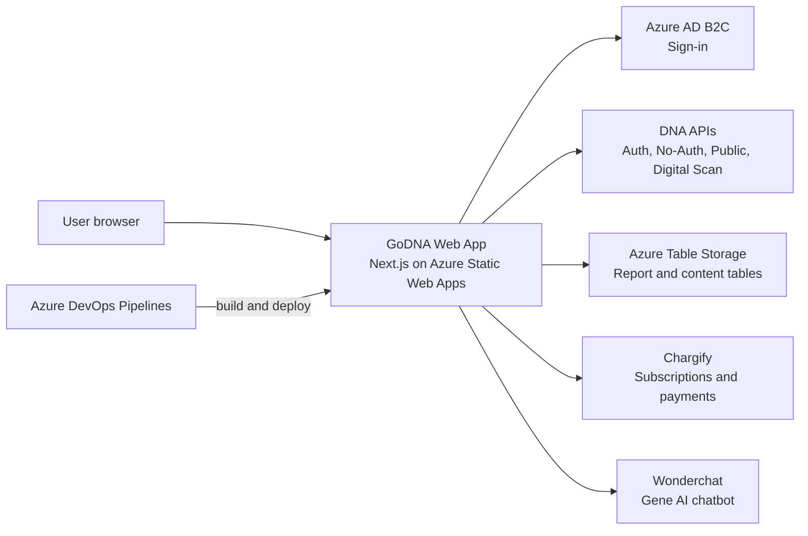

# GoDNA Web App – Documentation

12 October 2026

---

## 1. Project Overview

GoDNA is a web application, built with Next.js, that gives individuals and advisors insight into their financial and work behaviour ("DNA"). It is used by subscribed GoDNA users who sign in with their GoDNA account.

Users can sign up and subscribe, complete the DNA Discovery questionnaire, and view their dashboard, behaviour scores and unique style. They can also open and download Financial and Work Talents reports as PDF, see Market Mood, compare style matches with contacts, manage contacts and settings, update payment details, and chat with the Gene AI assistant.

Most data comes from the DNA backend APIs, while reference content (report text, trait descriptions, video links) is read from Azure Table Storage. The app is hosted on Azure Static Web Apps and is deployed automatically by Azure DevOps pipelines.

The user signs in through Azure AD B2C, and the app then calls the DNA APIs, Azure Table Storage, Chargify and Wonderchat directly to show data and handle payments and chat.

---

## 2. Tech Stack and Packages

The app uses Next.js 15 (App Router) with React 19 and TypeScript 5, and is built and run on Node.js 20.

| Package | Version | Purpose |
|---|---|---|
| next, react, react-dom | 15.3.0, ^19.0.0 | Web framework and UI rendering |
| typescript | ^5 | Programming language |
| tailwindcss, @tailwindcss/postcss, sass | ^4.1.4, ^4.1.4, ^1.86.3 | Styling |
| antd, @ant-design/icons, @ant-design/nextjs-registry | 6.1.1, 6.x, ^1.0.2 | UI component library |
| @ant-design/charts | ^2.6.7 | Charts and graphs |
| @reduxjs/toolkit, react-redux, redux-persist | ^2.6.1, ^9.2.0, ^6.0.0 | App state and saved session state |
| @tanstack/react-query, swr | ^5.72.2, ^2.3.8 | Data fetching and caching |
| @azure/msal-browser, @azure/msal-react, jwt-decode | ^4.27.0, ^3.0.23, ^4.0.0 | Sign-in with Azure AD B2C |
| html2pdf.js, jspdf, html2canvas | ^0.14.0, ^4.2.0, ^1.4.1 | PDF export of reports |
| react-hot-toast, nextjs-toploader | ^2.4.1, ^1.6.4 | User notifications and page-load bar |

Code quality is checked with ESLint (eslint-config-next) and TypeScript; no test runner is set up in package.json, and the full package list is in package.json.

---

## 3. Environment Configuration

Locally the app reads the .env file, while each pipeline build writes a .env.local file from a pipeline variable before building.

| Build configuration | Environment file | Source of values |
|---|---|---|
| Local development | .env | Developer's local file |
| Dev | .env.local (created at build) | Pipeline variable DEV_FE_ENV_VAR |
| QA | .env.local (created at build) | Pipeline variable QA_FE_ENV_VAR |
| Sandbox | .env.local (created at build) | Pipeline variable SANDBOX_FE_ENV_VAR |
| Production | .env.local (created at build) | Pipeline variable Prod_FE_ENV_VAR |

All variables are listed in .env.example; .env.dev and .env.qa are kept in the repository as reference copies.

| Variable | Description | Required |
|---|---|---|
| NEXT_PUBLIC_B2C_1_SIGNIN | Azure AD B2C sign-in policy / authority | Yes |
| NEXT_PUBLIC_CLIENT_ID | Azure AD B2C application (client) ID | Yes |
| NEXT_PUBLIC_MSAL_KNOWN_AUTHORITY | Trusted B2C sign-in domain | Yes |
| NEXT_PUBLIC_BASE_DNA_API_URL | Main DNA API (signed-in calls) | Yes |
| NEXT_PUBLIC_NO_AUTH_API_URL | DNA API for sign-up and products (no sign-in) | Yes |
| NEXT_PUBLIC_BASE_DNA_PUBLIC_API_URL | DNA public API | Yes |
| NEXT_PUBLIC_DIGITAL_SCAN_API_URL | Digital scan submission API | Yes |
| NEXT_PUBLIC_AZURE_TABLE_URL | Azure Table Storage address | Yes |
| NEXT_PUBLIC_AZURE_SHARED_ACCESS_KEY | Access token (SAS) for Azure Table Storage | Yes |
| NEXT_PUBLIC_CHARGIFY_PUBLIC_KEY | Chargify public key for the payment form | Yes |
| NEXT_PUBLIC_CHARGIFY_SERVER_HOST | Chargify server address | Yes |
| NEXT_PUBLIC_PRODUCT_HANDLE | Chargify product used at sign-up | Yes |
| NEXT_PUBLIC_DNA_TIMEOUT | Time limit for DNA API calls | Yes |
| NEXT_PUBLIC_SITE_URL | Public site address used in page metadata | No (defaults to godna.ai) |

---

## 4. Azure Storage and Expiry

Azure Storage is Microsoft's cloud service for storing data. This project uses **Azure Table Storage** to read reference content for reports and the dashboard, using a shared access (SAS) token.

The nearest known expiry is the Dev/QA SAS token on **8 January 2027**; if it is not renewed, report text, trait descriptions and style videos will stop loading in those environments.

| Storage account | Environments |
|---|---|
| sauatenvironment | Local, Dev, QA |
| To confirm | Sandbox, Production |

| Tables | Purpose |
|---|---|
| FinancialBehaviorReportSummary | Financial behaviour report summary text |
| CoachingReportTraitsTableV1 | Coaching and trait descriptions in reports |
| FactorRelationshipTable | Relationships between behaviour factors |
| BDNAUniqueStyleVideoLinks, FDNAUniqueStyleVideoLinks | Video links for Business DNA and Financial DNA unique styles |

| Item | Type | Expiry date |
|---|---|---|
| Dev/QA Table Storage access token | SAS token | 8 January 2027 |
| Sandbox Table Storage access token | SAS token | To confirm |
| Production Table Storage access token | SAS token | To confirm |
| Static Web App deployment tokens (SWA_DEV_TOKEN, SWA_QA_TOKEN, SWA_Sandbox_TOKEN, SWA_Prod_TOKEN) | Deployment token | To confirm |

---

## 5. Environments and Deployment

The development branch deploys to Dev and QA (azure-pipelines.yml), and the main branch deploys to Sandbox and Production (go-dna-sandbox-prod-pipelines.yml).

| Environment | URL | Branch | Deployment trigger |
|---|---|---|---|
| Dev | To confirm | development | Push or pull request to development |
| QA | To confirm | development | Push or pull request to development |
| Sandbox | To confirm | main | Push or pull request to main |
| Production | To confirm | main | Push or pull request to main |

Approval gates on the Azure DevOps environments (Dev, QA, GoDNA-Sandbox, GoDNA-Prod): To confirm.

### Deployment steps

1. Code is pushed (or a pull request is raised) to development or main, which starts the pipeline.
2. The pipeline sets up Node.js 20 and Yarn.
3. The environment variables for each environment are written into a .env.local file.
4. Dependencies are installed and the app is built with `yarn build`.
5. The build is packaged and published as a pipeline artifact.
6. The artifact is deployed to the matching Azure Static Web App using that environment's deployment token.
